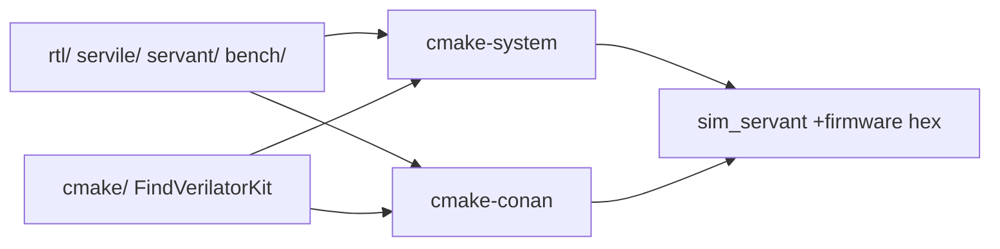

# CMake dual-tree (optional)

Pattern: [rtl-learning-plan](https://github.com/weiwan-gmail/rtl-learning-plan) `cmake-system/` + `cmake-conan/`.

FuseSoC, `Makefile`, and `verif/` are **unchanged**. This tree verilates the same Servant SoC as `make test_verilator` (`bench/servant_sim.v` + `bench/servant_tb.cpp` + existing RTL). It does **not** call FuseSoC and does not copy RTL.



`cmake-system` uses the machine Verilator kit. `cmake-conan` uses Conan 2 plus the local `recipes/verilator` (packages the system kit on Linux; [withlimon](https://github.com/withlimon/verilator-windows) `verilator_bin.exe` PE on Windows). Shared helpers live in `cmake/`: kit locate, MSVC `-fcoroutines*` strip, `ExpectPass.cmake`. `sc_time_stamp` is already in `bench/servant_tb.cpp`.

## Linux (proven)

Needs Verilator 5.x, CMake 3.24+, g++, `riscv64-unknown-elf-gcc` (for the C hello hex), and for the Conan tree also Conan 2.

```bash
cmake -S cmake-system -B build-system -DCMAKE_BUILD_TYPE=Release
cmake --build build-system --target sim
ctest --test-dir build-system --output-on-failure
```

```bash
export PATH="$HOME/.local/bin:$PATH"   # if pip --user conan
conan profile detect --force
cmake -S cmake-conan -B build-conan -DCMAKE_BUILD_TYPE=Release
cmake --build build-conan --target sim
ctest --test-dir build-conan --output-on-failure
```

Expect `Hello, SERV!` / `Test complete` / `verilator_exit=0` / `ALL TESTS PASSED.` (`ctest` also runs committed `sw/hello_uart.hex`).

Evidence: [`cmake-system/PASS_EVIDENCE.md`](cmake-system/PASS_EVIDENCE.md), [`cmake-conan/PASS_EVIDENCE.md`](cmake-conan/PASS_EVIDENCE.md).

## Windows (follow-up)

Drive **`verilator_bin.exe`** (PE), never extensionless Perl `verilator`. Notes: [`cmake-system/WINDOWS.md`](cmake-system/WINDOWS.md). `bench/servant_tb.cpp` is POSIX (`unistd.h`); prefer MinGW or WSL until a PC2023 re-run.

## Layout

| Path | Role |
|------|------|
| `cmake-system/` | Thin CMake project, system Verilator |
| `cmake-conan/` | Thin CMake project, Conan 2 + local recipe |
| `cmake/FindVerilatorKit.cmake` | Linux `verilator_bin` / Windows PE find |
| `cmake/ServantSim.cmake` | One `sim_servant` target, reuse existing TB |
| `sw/hello.hex` | Built by CMake via `sw/Makefile` (same as Make path) |
