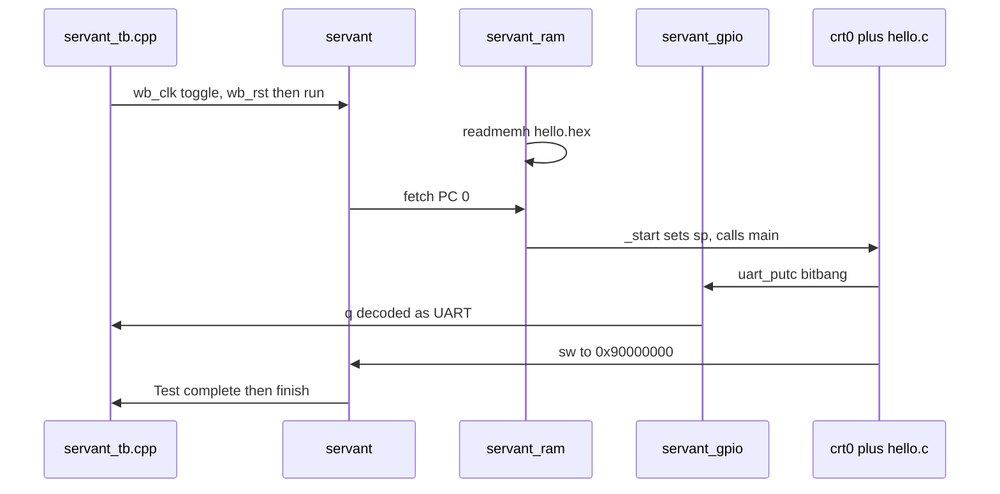

# SERV tutorial (English summary)

Full walkthrough: **[TUTORIAL_zh.md](TUTORIAL_zh.md)** (Chinese).
Proven logs: **[logs/](logs/)**. Command index: **[LEARNING.md](LEARNING.md)**.

## What SERV is

Olof Kindgren's **bit-serial** RV32I CPU — the area-extreme end of the
ladder. Default `W=1` processes **one bit per cycle** (LSB first). A typical
one-stage instruction is ~32 active cycles plus fetch, so CPI is tens, not
the ~1.7 of DarkRISCV or ~3–4 of PicoRV32. Optional `W=4` is QERV (4-bit
serial). Optional C / M / Zicsr.

This repository is `weiwan-gmail/serv` (fork of olofk/serv). Work here is on
**develop**. Upstream already had FuseSoC `verilator_tb` on the Servant SoC.
This fork adds a one-command Makefile, a small C hello, an Icarus path that
does not need `fusesoc-cores`, and tutorials. Core RTL is unchanged.

**Co-sim choice:** compile C (or the official `hello_uart.S`) to `.hex`,
`$readmemh` into Servant RAM, Verilator C++ only driving clock/reset and
decoding the bit-banged UART. That matches how Servant was written; a
separate C ISS is not added.

## Repo map

| Path | Role |
|------|------|
| `rtl/serv_*.v` | bit-serial CPU (`serv_top` + `serv_state` bit counter) |
| `servile/` | convenience wrapper; sim halt at `0x90000000` |
| `servant/` | FPGA SoC: RAM + GPIO + timer |
| `bench/servant_tb.cpp` | Verilator clock / UART / timeout |
| `sw/hello.c` | documented C demo |
| `sw/hello_uart.S` | official assembly UART demo |
| `servant.core` | FuseSoC targets (`verilator_tb`, `sim`, boards) |

## How firmware boots



1. `$readmemh` fills 8 KiB RAM from `sw/hello.hex`.
2. `crt0.S` sets `sp=_stack` (top of RAM), `call main`.
3. `hello.c` idles GPIO high and prints **`Hello, SERV!\n`** via `uart.S`
   (same timing as `hello_uart.S`, ~57600 baud at 16 MHz).
4. Return to crt0; store to `0x90000000`; `servile_mux` prints
   `Test complete` and `$finish`.

Memory map (Servant): `0x00000000` RAM, `0x40000000` GPIO (UART/`q`),
`0x80000000` timer / signature, `0x90000000` sim halt.

## Install tools

```bash
sudo apt-get install -y iverilog verilator gcc-riscv64-unknown-elf python3 python3-pip build-essential
pip3 install --user fusesoc
export PATH="$HOME/.local/bin:$PATH"
make toolchain-info
```

Verified here: Icarus 12.0, Verilator 5.020, FuseSoC 2.4.7,
`riscv64-unknown-elf-gcc` 13.2.0.

## Build C → Verilator → Icarus

```bash
make test_verilator
# Hello, SERV!
# Test complete
# SIM DONE after 44423 clock cycles
# verilator_exit=0
# ALL TESTS PASSED.

make test_icarus
# same UART text; Test complete

make test_verilator_asm
# Hi, I'm Servant!
```

## PASS / FAIL

- **PASS (Verilator):** `Hello, SERV!`, `Test complete`, `ALL TESTS PASSED.` /
  `verilator_exit=0`.
- **PASS (Icarus):** same UART text and `Test complete`.
- **Timeout:** `TIMEOUT after N clock cycles` / `verilator_exit=2` (blinky
  never `$finish`es).

Logs from a real run:

- Icarus: [logs/04-iverilog-hello.txt](logs/04-iverilog-hello.txt)
- Verilator: [logs/05-verilator-hello.txt](logs/05-verilator-hello.txt)

## Contrast vs earlier rungs

| Core | Microarchitecture | Typical CPI |
|------|-------------------|-------------|
| picorv32 | multi-cycle, `mem_valid/ready` | ~3–4 |
| FemtoRV `step20` | teaching multi-cycle FSM | tens |
| darkriscv | 3-stage, no stall/forward | ~1.7 |
| **SERV** | **bit-serial, 1 bit/cycle** | **~32+** |

Same RV32I software view; SERV trades performance for ~200 LUT / 2.1 kGE.

## Next (ladder complete)

RISC-V forks are done. Optional follow-ups from Wei's `rtl-learning-plan`:
**PWM (P6)** and **Track B DSP**. Stay on this tree until
`make test_verilator` is green, then read `rtl/serv_state.v` (bit counter)
and `rtl/serv_alu.v` (1-bit adder with carry flop).
