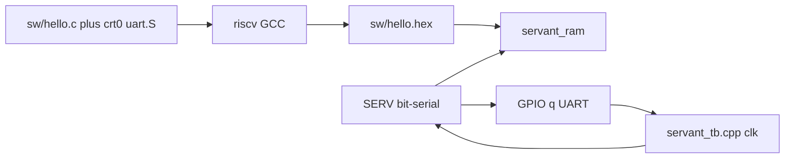
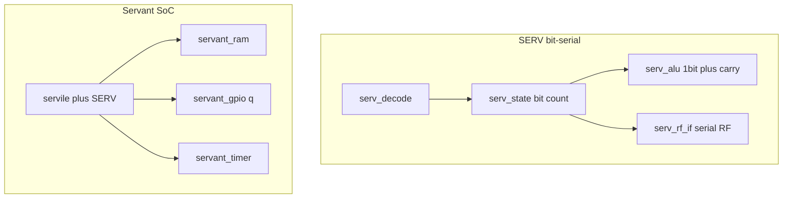
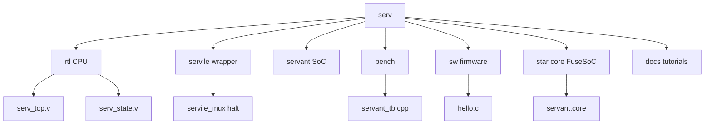
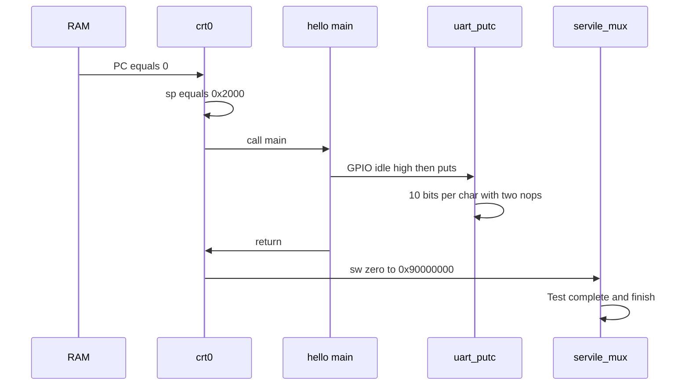
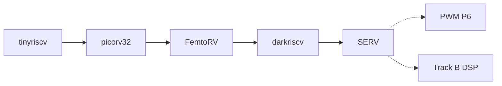

# SERV 学习教程（中文主文档）

面向 Wei 的完整上手说明：从仓库结构、位串行微结构，到用
**C 交叉编译 → hex 灌 RAM → FuseSoC Verilator / Icarus 同镜像仿真**
跑通 `Hello, SERV!`。

英文摘要：[TUTORIAL.md](TUTORIAL.md)
命令速查：[LEARNING.md](LEARNING.md)
本教程里每一条关键命令都在 [logs/](logs/) 里有**真实终端输出**，不是口头推演。

> 工作分支：`weiwan-gmail/serv` 的 **develop**（上游为
> [olofk/serv](https://github.com/olofk/serv)）。
> **不改 CPU RTL**（`rtl/serv_*.v` 保持原样）。只补了 Makefile 包装、一份
> 裸机 C hello、不依赖 `fusesoc-cores` 的 Icarus 路径，以及本教程。
>
> 上一档梯子是 DarkRISCV（三级流水、DSP 风格、CPI ≈ 1.7）。
> SERV 是梯子的**最后一档 RISC-V 核**：同样 RV32I，每个周期大约只推进
> **1 bit**，用时间换面积。

---

## 0. 选了哪种 co-sim，为什么

SERV **本来就**用 FuseSoC 把 Servant SoC 交给 Verilator：
`fusesoc run --target=verilator_tb servant --firmware=….hex`。
`servant_sim.v` 用 `$readmemh` 灌 RAM；`bench/servant_tb.cpp` 只翻转
`wb_clk` / `wb_rst`，并把 GPIO `q` 解成 UART。固件往 `0x90000000` 一写，
`servile_mux` 就 `$display("Test complete")` 再 `$finish`。

所以这里采用 **「C 固件 hex + 官方 Verilator TB」**，而不是再写一个
C 指令集模拟器去对拍。对这个仓库来说，hex 路径才是自然 co-sim：CPU 真正
执行交叉编译出来的机器码，C++ 侧不是第二套 CPU。

Zephyr hello（`sw/zephyr_hello.hex`）也是 C，但是 UART 打完
`Hello World! service` 之后**不会** `$finish`，README 写的是 Ctrl-C 停。
那不是自检 PASS。

学习用 demo 是 **裸机 C hello**（`make test_verilator`）：打印
`Hello, SERV!`，写 halt 地址，TB 打出 `Test complete` /
`ALL TESTS PASSED.`。官方汇编 `sw/hello_uart.S`（`Hi, I'm Servant!`）
仍然可用 `make test_verilator_asm`，上游 hex 没改。



---

## 1. SERV 是什么

Olof Kindgren 的 **位串行** RISC-V：ALU、立即数、PC 都按 bit 推进，默认
`W=1`（一拍 1 bit，LSB 先）。可选 `W=4` 叫 QERV。目标是**面积最小**的
RV32I，不是最快。

| 项 | 默认（教学） |
|----|----------------|
| 数据通路 | 1-bit 串行（`W=1`） |
| 一条一阶段指令 | 约 32 拍运算 + 取指开销 |
| 复位 PC | `0` |
| 参考 SoC | Servant：RAM + 1-bit GPIO + timer |
| ISA | RV32I；可选 C / M / Zicsr |
| 面积（手册） | iCE40 ≈ 198 LUT / 164 FF；CMOS ≈ 2.1 kGE |

和前面几档的差别（本档要记住的）：

| 核 | 微结构 | 软件还能不能当 RV32I 用 |
|----|--------|-------------------------|
| tinyriscv | 三级流水 + RIB | 能 |
| picorv32 | 多周期，`mem_valid/ready`，CPI ~3–4 | 能 |
| FemtoRV `step20` | 教学多周期状态机 | 能 |
| darkriscv | 三级、级间不 stall / 不 forwarding，CPI ~1.7 | 能 |
| **SERV** | **位串行，一拍 1 bit，CPI 几十** | **能（同一套 hex）** |

picorv32 / darkriscv 每个周期处理一整字；SERV 把「字」拆成 32 个 bit
时间片。`serv_state` 里的 `o_cnt` 就是当前 bit 序号。`serv_alu` 是带进位
触发器的 1-bit 加法器，不是 32-bit ALU。



---

## 2. 仓库地图



| 路径 | 作用 |
|------|------|
| `rtl/serv_top.v` | CPU 顶层 |
| `rtl/serv_state.v` | 阶段 / bit 计数 / 取指与写回时序 |
| `rtl/serv_alu.v` | 1-bit ALU + 进位 |
| `servile/servile.v` | 方便包装：仲裁、mux、可选 MDU |
| `servile/servile_mux.v` | 仿真：`0x80000000` 签名、`0x90000000` halt |
| `servant/servant.v` | FPGA 参考 SoC |
| `servant/servant_ram.v` | `$readmemh`；`/* verilator public */` |
| `bench/servant_sim.v` | 运行时 `+firmware=` 灌 RAM |
| `bench/servant_tb.cpp` | Verilator：时钟、UART、超时、PASS 行 |
| `bench/servant_tb.v` | 上游 Icarus TB（依赖 `vlog_tb_utils`） |
| `sim/icarus/servant_tb_lite.v` | 教学 Icarus TB（无 FuseSoC 库） |
| `sw/hello.c` + `crt0.S` + `uart.S` | 文档里的 C demo |
| `sw/hello_uart.S` | 官方汇编 UART demo |
| `servant.core` | FuseSoC：`verilator_tb` / `sim` / 各 FPGA 板 |
| `verif/` | RISCOF 合规（本档绿色命令不跑） |
| `doc/` | 上游 Sphinx 手册（注意没有 s） |
| `docs/` | 本教程 |

上游 FPGA 板级文件在 `servant/` + `data/`，本档不碰。

---

## 3. 固件怎么从 0 跑起来

链接脚本 `sw/link.ld`：`.text` 从 `0` 开始；`_stack = 0x2000`（默认
8 KiB RAM 顶）。仿真和「把 hex 预载进片上 RAM」是同一条软件路径。

### 3.1 硬件侧

1. C++（或 Icarus `initial`）先让 `wb_rst=1`，约 100 ns 后再拉低。
2. `servant_sim` 的 `initial` 读 `+firmware=`，`$readmemh` 进
   `dut.ram.mem`。
3. CPU 从地址 0 取指。Servant 内存图：

| 地址 | 用途 |
|------|------|
| `0x00000000`–`0x3FFFFFFF` | RAM（指令+数据+栈） |
| `0x40000000` | 1-bit GPIO → 板级 LED / 仿真 UART `q` |
| `0x80000000` | timer；仿真里还可当 signature 字节口 |
| `0x90000000` | 仿真 halt（`sim=1` 时 `$finish`） |

### 3.2 软件侧（`crt0.S` + `hello.c`）



1. `_start`：`la sp, _stack`，`call main`。
2. `main` 先把 GPIO 写成 1（UART 空闲高），再 `uart_puts("Hello, SERV!\n")`。
3. `uart_putc` 与 `hello_uart.S` **同一套** bitbang（`ori 0x100` / `slli 1`
   再逐位 `sb`，中间两拍 `nop`），在 16 MHz SERV 上大约 57600 baud。
4. `main` 返回后 crt0 写 `0x90000000`；`servile_mux` 打印 `Test complete`
   并 `$finish`。

C → 镜像：

```
crt0.S + uart.S + hello.c
  → gcc -march=rv32i_zicsr -mabi=ilp32
  → objcopy binary
  → makehex.py  pad to 2048 words
  → sw/hello.hex
```

这就是和 picorv32 / FemtoRV / DarkRISCV 同一类的 **hex 灌 RAM**。

Make 的默认 `CC` 是宿主机 `cc`，所以 `sw/Makefile` 用
`CC = $(TOOLCHAIN_PREFIX)gcc`，不要写 `CC?=`。

---

## 4. 安装工具

```bash
sudo apt-get install -y iverilog verilator gcc-riscv64-unknown-elf python3 python3-pip build-essential
pip3 install --user fusesoc
export PATH="$HOME/.local/bin:$PATH"
make toolchain-info
```

本档实跑版本（见 [logs/01-inspect.txt](logs/01-inspect.txt)）：

```
TOOLCHAIN_PREFIX=riscv64-unknown-elf-
riscv64-unknown-elf-gcc (13.2.0-11ubuntu1+12) 13.2.0
fusesoc 2.4.7
Verilator 5.020 2024-01-01
Icarus Verilog version 12.0 (stable)
```

`pip install --user fusesoc` 装到 `~/.local/bin`。仓库根 Makefile 会把
该目录.prepend 进 `PATH`。根 Makefile 用
`fusesoc --cores-root=.`，**不必**再 `fusesoc library add`，也不必克隆
`fusesoc-cores`（那个库只给上游 Icarus `sim` 目标的 `vlog_tb_utils`）。

---

## 5. 绿色命令：Verilator + C hello

```bash
make test_verilator
```

内部是：

1. `make -C sw hello` → `sw/hello.hex`
2. `fusesoc --cores-root=. run --target=verilator_tb --build-root=sim/fusesoc-build servant --uart_baudrate=57600 --timeout=200000000 --firmware=sw/hello.hex`
3. `grep` `Hello, SERV!`、`Test complete`、`verilator_exit=0`、
   `ALL TESTS PASSED.`

本档实跑（[logs/05-verilator-hello.txt](logs/05-verilator-hello.txt)）：

```
Loading RAM from /workspace/sw/hello.hex
Hello, SERV!
Test complete
SIM DONE after 44423 clock cycles
verilator_exit=0
ALL TESTS PASSED.
```

44423 拍看起来「很多」，对位串行核是正常的：每个 `sb`/`nop` 都要跑完
~32 bit 时间片，UART 每位还故意空两拍。DarkRISCV 打更长欢迎语只要
~6.7 万拍，是因为那边 CPI ≈ 1.7。

官方汇编对照：

```bash
make test_verilator_asm
# Hi, I'm Servant!  /  SIM DONE after 53739 clock cycles
```

日志：[logs/06-verilator-hello_uart.txt](logs/06-verilator-hello_uart.txt)。

可选 VCD（上游 plusarg，未改协议）：

```bash
fusesoc --cores-root=. run --target=verilator_tb servant \
  --firmware=$PWD/sw/hello.hex --uart_baudrate=57600 --timeout=200000000 --vcd
```

---

## 6. 同一份镜像：Icarus

```bash
make test_icarus
```

这是 `iverilog -c sim/rtl.f` + `vvp … +firmware=sw/hello.hex`，TB 是
`sim/icarus/servant_tb_lite.v`（没有 `vlog_tb_utils`）。UART 文本应与
Verilator 相同。完整日志：
[logs/04-iverilog-hello.txt](logs/04-iverilog-hello.txt)。

上游 Icarus 目标仍是：

```bash
fusesoc run --target=sim servant --firmware=…   # 需要 fusesoc-cores
```

教学路径**不要求**那条，以免再克隆一个库。不要改 FPGA / Zephyr /
RISCOF。

---

## 7. 怎么判断 PASS / FAIL

| 现象 | 含义 |
|------|------|
| `Loading RAM from … hello.hex` | `$readmemh` 找到文件 |
| `Hello, SERV!` | C `main` 的 GPIO UART 被 TB 解出来 |
| `Test complete` | `0x90000000` 触发 `$finish` |
| `SIM DONE after N clock cycles` | Verilator 看到 `$finish`，不是超时 |
| `verilator_exit=0` / `ALL TESTS PASSED.` | Makefile 的 grep 也过了 |
| `TIMEOUT` / `verilator_exit=2` | `--timeout` 到了还没 halt（blinky 会这样） |
| 乱码 UART | 波特率/`q` 极性/固件没灌进去 |

Makefile 会同时 `grep` 字符串和 `Test complete`，避免「随便 `$finish` 也算过」。

`blinky.hex` 只翻转 LED，**不会**结束仿真，不是本档 PASS demo。

---

## 8. 可选、但不是绿色命令

- **Zephyr：** `sw/zephyr_*.hex` + README 里的 `verilator_tb`；要 Ctrl-C。
  完整 west 流程见上游 README。
- **RISCOF：** `verif/` 对照 sail-riscv 跑 RV32I/M/C。CI 用这条，本教程不跑。
- **riscv-formal：** `.github/workflows/formal.yml`。
- **QERV：** `--width=4`（4-bit 串行）。面积/周期折中，入门先 `W=1`。
- **FPGA `servant/` 各板：** 仿真过了再碰。
- **M 扩展：** 另加 `mdu` FuseSoC 库。

---

## 9. 建议阅读顺序（过绿之后）

1. `servile/servile_mux.v` 里 `sim` generate：`halt_en` / `$finish`。
2. `servant/servant_gpio.v` + `bench/servant_tb.cpp` 的 UART 解码。
3. `rtl/serv_state.v`：`o_cnt`、`o_cnt_done`、一阶段 vs 两阶段指令。
4. `rtl/serv_alu.v`：1-bit 加法和 `add_cy_r`。
5. 对照 DarkRISCV 的三级流水、picorv32 的 `mem_valid/ready`：同一 ISA，
   时序模型完全不同。

官方手册（门级框图）：<https://serv.readthedocs.io/en/latest/>

---

## 10. 梯子到此结束；可选下一步



**tinyriscv → picorv32 → FemtoRV → DarkRISCV → SERV** 已经走完。

同一套 RV32I 软件模型，微结构从「能跑指令的流水线」走到「一拍 1 bit
的面积极限」。不必再开第五个 RISC-V fork。

可选（Wei 的 [rtl-learning-plan](https://github.com/weiwan-gmail/rtl-learning-plan)）：

1. **PWM P6** — 自检 DUT（phase-acc 或 counter-compare；`duty`/`period`
   assert）。帖子工作向缺口，用 iverilog 即可。
2. **Track B DSP** — 定点 / FIR / 选讲 FFT 或 CIC（路线图 N6 / §7）。

读 SERV 之前请先让本仓库的 `make test_verilator` 保持绿色，并搞清楚
`serv_state` 的 bit 计数——再去看「一条 `addi` 为什么要三十多拍」会更有感觉。
